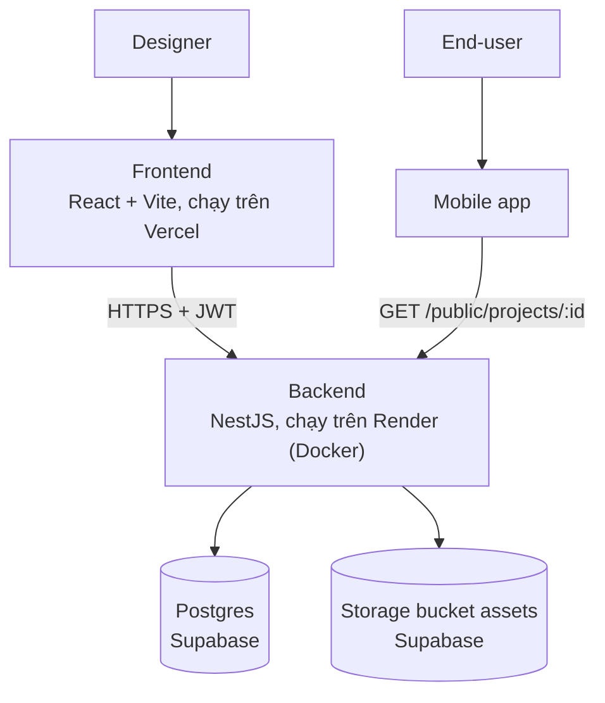
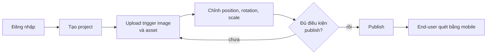

# Architecture

Hệ thống AR gồm 3 phần: web designer tool, backend API, và app mobile cho end-user quét.

Chú thích: Frontend → [[Frontend]] · Backend → [[Backend]] · Postgres → [[Database-Schema]] · Storage → [[Supabase-Storage]] · Mobile → [[Mobile-App]] và [[API-Public-Scan]].

## Luồng nghiệp vụ chính
1. Designer đăng nhập ([[Auth-Tokens]], hoặc [[Auth-Google-OAuth]]) rồi tạo project ([[API-Projects]]).
2. Upload **trigger image** (ảnh dùng để quét) và các asset: model 3D, ảnh, video ([[API-Assets]], kiểm tra theo [[Upload-Validation]]).
3. Chỉnh vị trí/xoay/tỉ lệ từng asset trong [[Project-Editor]] ([[Asset-Transform]]).
4. Bấm Publish; backend kiểm tra đủ điều kiện ([[Publish-Flow]]).
5. End-user mở [[Mobile-App]], nhập Project ID, đưa camera vào trigger image; app tải asset qua [[API-Public-Scan]] và vẽ đè lên ảnh.

## Quyết định thiết kế đáng nhớ
- Backend tự cấp JWT riêng, **không dùng Supabase Auth**; Supabase chỉ là Postgres + Storage. Vì vậy [[Row-Level-Security]] chỉ để khoá đường vào trực tiếp, không dùng để phân quyền theo user.
- Mobile chỉ nói chuyện với backend qua một route public, không gọi thẳng Supabase.
- Repo là pnpm workspace gồm `frontend` và `backend`; `mobile` bị loại khỏi workspace.
