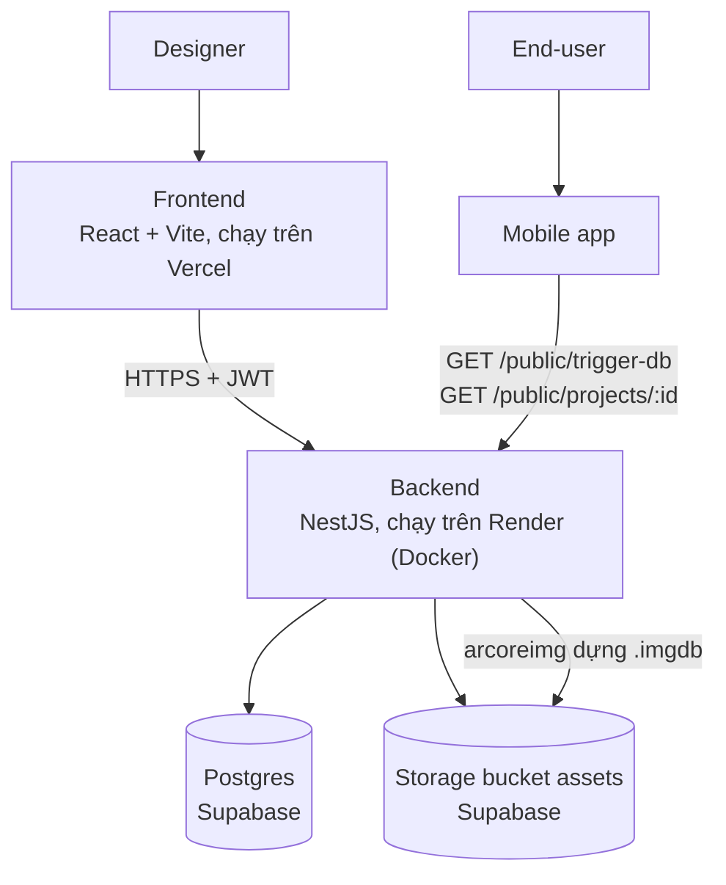
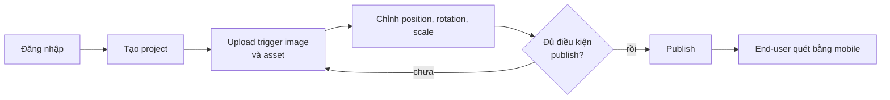

# Architecture

Hệ thống AR gồm 3 phần: web designer tool, backend API, và app mobile cho end-user quét.

Chú thích: Frontend → [[Frontend]] · Backend → [[Backend]] · Postgres → [[Database-Schema]] · Storage → [[Supabase-Storage]] · Mobile → [[Mobile-App]] và [[API-Public-Scan]] · database nhận diện → [[Trigger-Database]].

## Luồng nghiệp vụ chính
1. Designer đăng nhập ([[Auth-Tokens]], hoặc [[Auth-Google-OAuth]]) rồi tạo project ([[API-Projects]]).
2. Upload **trigger image** (ảnh dùng để quét) và các asset: model 3D, ảnh, video ([[API-Assets]], kiểm tra theo [[Upload-Validation]]).
3. Chỉnh vị trí/xoay/tỉ lệ từng asset trong [[Project-Editor]] ([[Asset-Transform]]).
4. Bấm Publish; backend kiểm tra đủ điều kiện ([[Publish-Flow]]) rồi dựng lại database nhận diện gồm trigger image của mọi project đã publish ([[Trigger-Database]]).
5. End-user mở [[Mobile-App]] (không cần nhập Project ID), đưa camera vào trigger image bất kỳ; ARCore nhận ra project nào thì app tải asset của project đó qua [[API-Public-Scan]] và vẽ đè lên ảnh.

## Quyết định thiết kế đáng nhớ
- Backend tự cấp JWT riêng, **không dùng Supabase Auth**; Supabase chỉ là Postgres + Storage. Vì vậy [[Row-Level-Security]] chỉ để khoá đường vào trực tiếp, không dùng để phân quyền theo user.
- Mobile chỉ nói chuyện với backend qua route public (`/public/trigger-db`, `/public/projects/:id`), không gọi thẳng Supabase API; chỉ tải file theo URL public.
- Database nhận diện ảnh dựng **trên server** bằng `arcoreimg`, không dựng trên điện thoại ([[Trigger-Database]]).
- Repo là pnpm workspace gồm `frontend` và `backend`; app mobile là repo riêng `ARMobile`, có wiki riêng ([[Mobile-App]]).
