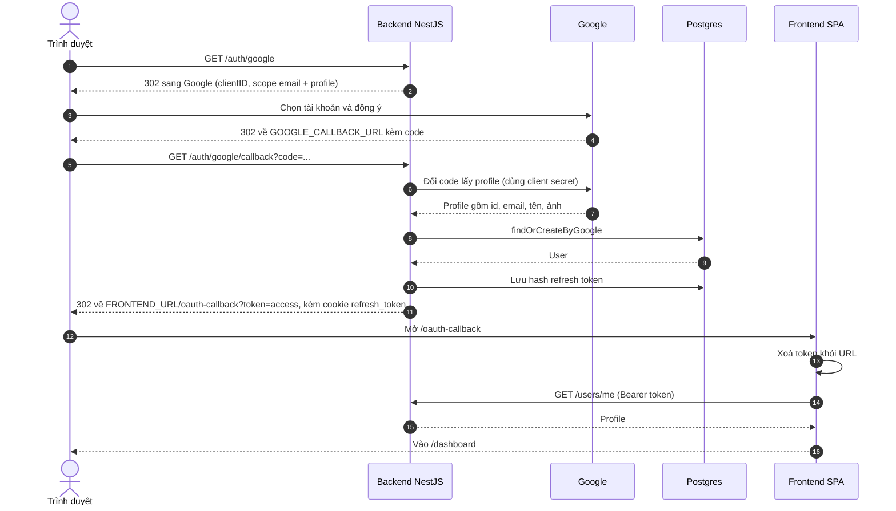
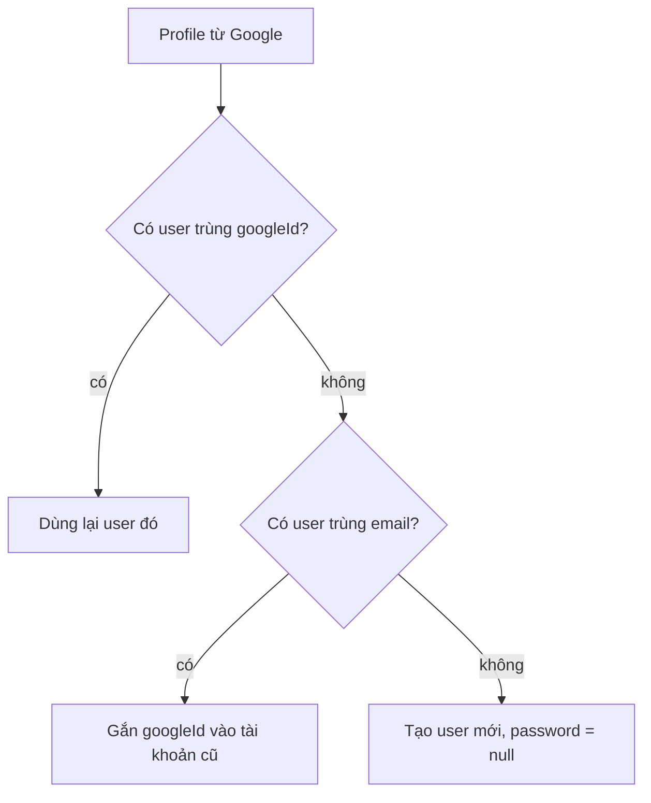

# Auth-Google-OAuth

Đăng nhập bằng Google dùng `passport-google-oauth20` ([[Module-Auth]]). Sau khi xong, mọi thứ chạy bằng JWT của chính dự án ([[Auth-Tokens]]).

## Luồng

Cách `findOrCreateByGoogle` chọn user:

Frontend: nút ở `/login` và `/signup`, trang `/oauth-callback` ([[Frontend-Routes]]); hàm `loginWithToken` ([[Frontend-AuthContext]]).

## Gộp tài khoản (`findOrCreateByGoogle`, [[Module-User]])
1. Trùng `googleId` → dùng lại user đó.
2. Trùng email (từng đăng ký bằng mật khẩu) → **gắn `googleId` vào tài khoản cũ**, không tạo trùng; từ đó đăng nhập được bằng cả hai cách.
3. Không có → tạo user mới với `password = null` (đổi mật khẩu bị chặn rõ ràng, [[API-Users]]).

## Cấu hình
Google Cloud Console → OAuth client loại Web; **Authorized redirect URI phải khớp từng ký tự** với `GOOGLE_CALLBACK_URL` và trỏ về **backend**. Biến cần: `GOOGLE_CLIENT_ID`, `GOOGLE_CLIENT_SECRET`, `GOOGLE_CALLBACK_URL`, `FRONTEND_URL` ([[Environment-Variables]]). Chúng bắt buộc để backend khởi động. Ứng dụng ở chế độ Testing chỉ cho email nằm trong danh sách test user.

## Hạn chế đã biết ([[Security-Notes]], [[Roadmap]])
- Chưa có tham số `state` chống login CSRF.
- Lỗi xảy ra trước controller (người dùng bấm Từ chối, code hết hạn) hiện ra JSON ở domain backend, chưa redirect về frontend.
- Access token nằm trên URL ở bước 6.

Sự cố từng gặp: [[Troubleshooting]].
