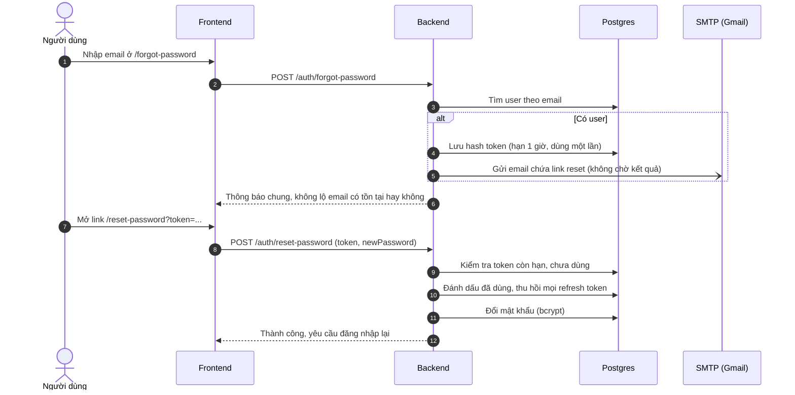

# Auth-Password-Reset

## Luồng

Từng bước chi tiết:

1. `/forgot-password` (frontend) → `POST /auth/forgot-password` với email ([[API-Auth]]).
2. Backend **luôn trả cùng một thông báo** dù email có tồn tại hay không, để không ai dò được email nào đã đăng ký.
3. Nếu có user: sinh token ngẫu nhiên 32 byte, lưu **hash sha256** vào `PasswordResetToken` (hạn **1 giờ**, dùng một lần) ([[Database-Schema]]).
4. Link `FRONTEND_URL/reset-password?token=...` được gửi tới email user qua SMTP, mặc định Gmail (`MailService` dùng `nodemailer`, cấu hình `SMTP_USER` + `SMTP_PASS`). Backend **không chờ** gửi xong để thời gian phản hồi không lộ email có tồn tại; lỗi gửi chỉ được log. Ở local thiếu `SMTP_USER`/`SMTP_PASS` thì link được in ra log backend (`[DEV ONLY]`); ở production thiếu thì không gửi và log lỗi, không bao giờ in link.
5. `/reset-password` (frontend) → `POST /auth/reset-password` với `token` và `newPassword`.
6. Backend kiểm tra token còn hạn và chưa dùng, đánh dấu đã dùng, **thu hồi mọi refresh token** của user (phải đăng nhập lại ở mọi thiết bị, [[Auth-Tokens]]), rồi đổi mật khẩu bằng [[Module-User]].

## Cấu hình khi deploy
Đặt `SMTP_USER` (địa chỉ Gmail) và `SMTP_PASS` (App Password, cần bật 2-Step Verification) trên Render. Gmail giới hạn khoảng 500 email/ngày; email gửi đi từ chính địa chỉ Gmail đó. Đổi sang nhà cung cấp khác (Brevo, Resend có domain riêng…) chỉ cần đặt thêm `SMTP_HOST`/`SMTP_PORT`.

Cả hai route bị giới hạn 5 lần/phút/IP ([[Rate-Limiting]]). Giao diện: [[Frontend-Routes]]. Lưu ý tài khoản Google-only chưa có mật khẩu nhưng vẫn có thể dùng luồng này để đặt mật khẩu lần đầu.
