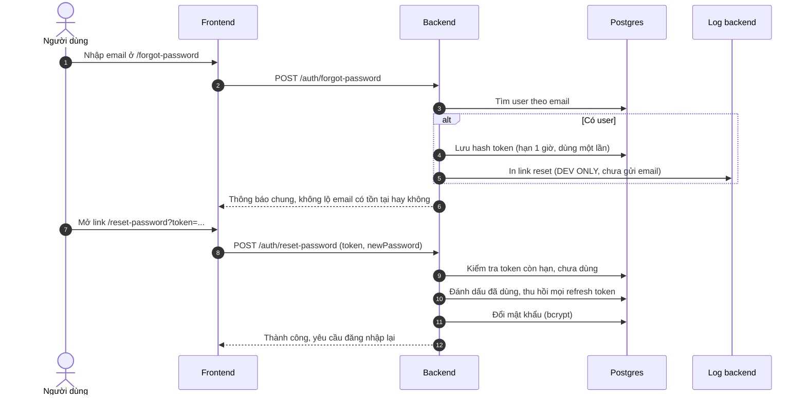

# Auth-Password-Reset

## Luồng

Từng bước chi tiết:

1. `/forgot-password` (frontend) → `POST /auth/forgot-password` với email ([[API-Auth]]).
2. Backend **luôn trả cùng một thông báo** dù email có tồn tại hay không, để không ai dò được email nào đã đăng ký.
3. Nếu có user: sinh token ngẫu nhiên 32 byte, lưu **hash sha256** vào `PasswordResetToken` (hạn **1 giờ**, dùng một lần) ([[Database-Schema]]).
4. Link `FRONTEND_URL/reset-password?token=...` được tạo. **Hiện chưa gửi email**: link chỉ in ra log backend, đánh dấu `[DEV ONLY]`.
5. `/reset-password` (frontend) → `POST /auth/reset-password` với `token` và `newPassword`.
6. Backend kiểm tra token còn hạn và chưa dùng, đánh dấu đã dùng, **thu hồi mọi refresh token** của user (phải đăng nhập lại ở mọi thiết bị, [[Auth-Tokens]]), rồi đổi mật khẩu bằng [[Module-User]].

## Việc bắt buộc trước khi dùng thật
Nối dịch vụ gửi mail (Resend, SendGrid, SES…). Hiện ai đọc được log server cũng lấy được link đặt lại mật khẩu của bất kỳ ai ([[Security-Notes]], [[Roadmap]]).

Cả hai route bị giới hạn 5 lần/phút/IP ([[Rate-Limiting]]). Giao diện: [[Frontend-Routes]]. Lưu ý tài khoản Google-only chưa có mật khẩu nhưng vẫn có thể dùng luồng này để đặt mật khẩu lần đầu.
