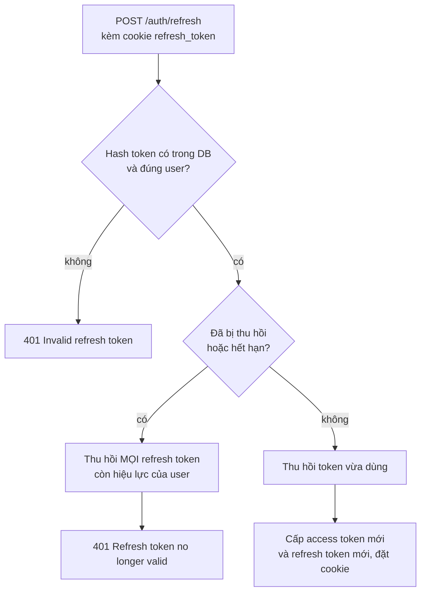
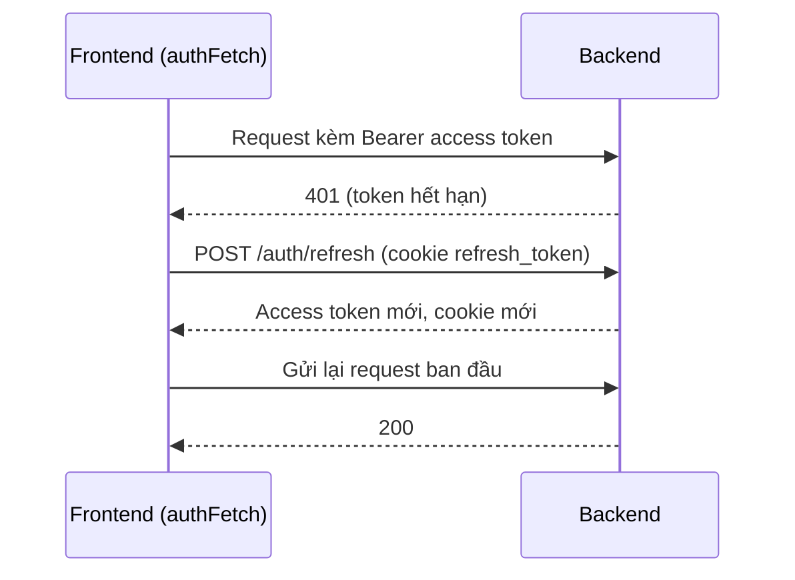

# Auth-Tokens

Backend tự cấp JWT, không dùng Supabase Auth ([[Architecture]]).

| | Access token | Refresh token |
|---|---|---|
| Hạn | 1 ngày | 7 ngày |
| Khoá ký | `JWT_SECRET` | `JWT_REFRESH_SECRET` |
| Payload | `sub` (id user), `email`, `role`, `type: access` | tương tự, `type: refresh` |
| Cách gửi | Header `Authorization: Bearer` | Cookie `refresh_token` |
| Lưu ở client | `localStorage` ([[Frontend-AuthContext]]) | cookie `httpOnly` |
| Lưu ở server | không | chỉ **hash sha256** trong bảng `RefreshToken` ([[Database-Schema]]) |

## Cookie refresh
`httpOnly`, `Path=/auth`, 7 ngày. Môi trường production: `Secure` + `SameSite=None` (vì frontend và backend khác domain); local: `SameSite=Lax`.

## Xoay token và phát hiện dùng lại
`POST /auth/refresh` ([[API-Auth]]) chỉ dùng được **một lần**: token vừa dùng bị thu hồi và cặp mới được cấp.

Token đã thu hồi mà vẫn bị đưa ra nghĩa là có thể đã bị lộ và bị dùng lại, nên cả phiên của user bị đóng. Token **hết hạn** cũng đi nhánh này: người dùng phải đăng nhập lại ở mọi thiết bị.

## Frontend tự làm mới khi access token hết hạn

Nếu bước refresh cũng lỗi thì frontend `logout` ([[Frontend-AuthContext]]).

## Khi nào mọi refresh token bị thu hồi
- Đặt lại mật khẩu thành công ([[Auth-Password-Reset]]).
- Gửi refresh token đã thu hồi hoặc đã hết hạn lên `/auth/refresh` (sơ đồ trên).

Frontend tự gọi refresh khi gặp 401 ([[Frontend-AuthContext]]). Hai chiến lược xác thực: `JwtStrategy`, `RefreshTokenStrategy` ([[Module-Auth]]). Rủi ro lưu token: [[Security-Notes]].
