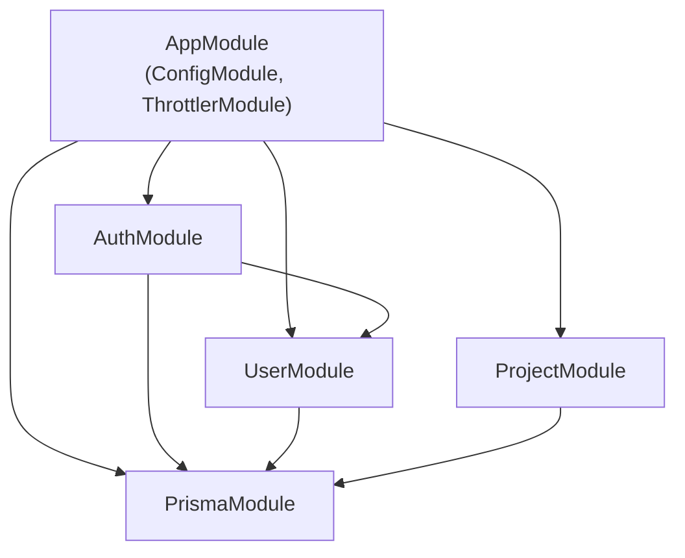
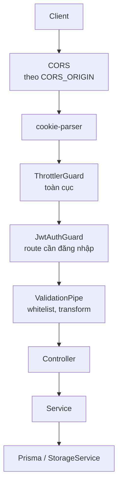

# Backend

REST API viết bằng NestJS 11 + Prisma + PostgreSQL (Supabase). Thư mục `backend/src`.

## Module
| Module | Vai trò |
|---|---|
| [[Module-Auth]] | Đăng nhập, đăng ký, token, Google, quên mật khẩu |
| [[Module-User]] | Dữ liệu user và `/users/me` |
| [[Module-Project]] | Project, asset, trigger image, publish, scan public |
| [[Prisma-Setup]] | `PrismaService` dùng chung |

## Quan hệ giữa các module

## Đường đi của một request

## Cấu hình khởi động (`main.ts`, `app.module.ts`)
- `cookie-parser` để đọc refresh token từ cookie.
- **CORS** theo `CORS_ORIGIN` (mặc định `localhost:5173` và domain Vercel), bật `credentials`.
- `ValidationPipe` với `whitelist`, `forbidNonWhitelisted`, `transform`: field lạ trong body bị từ chối (400).
- Swagger tại `/docs`, chỉ khi `NODE_ENV !== 'production'` ([[Swagger-Docs]]).
- `ConfigModule` toàn cục; `ThrottlerGuard` toàn cục ([[Rate-Limiting]]).
- Cổng lấy từ `PORT`, mặc định 3000.

Có test `.spec.ts` (Jest) cho auth, user, project, asset và validate upload: `pnpm --filter backend test`.

Liên quan: [[Database-Schema]] · [[Supabase-Storage]] · [[Environment-Variables]] · [[Deployment]] · [[Security-Notes]]
