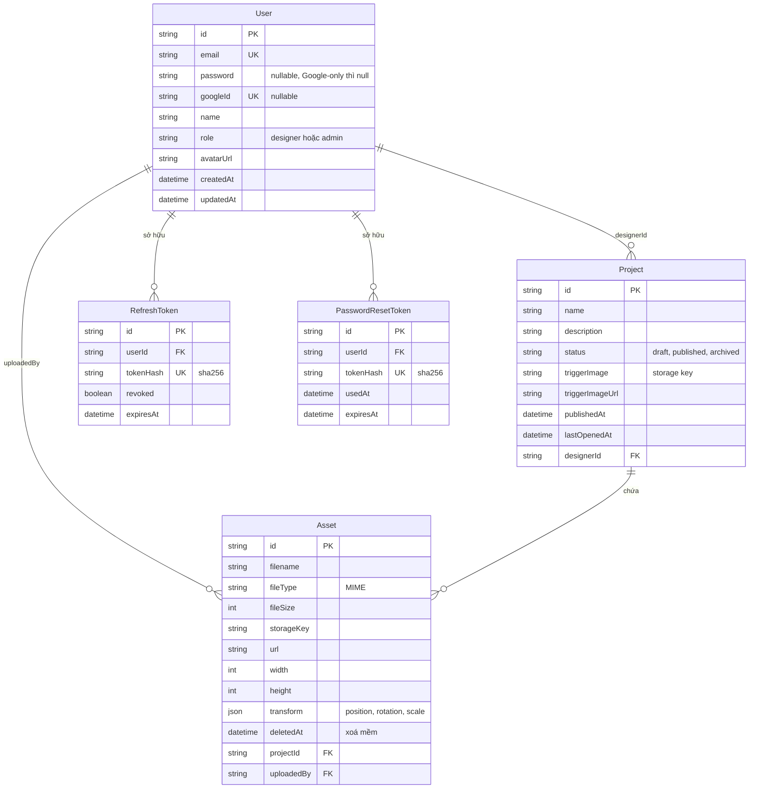

# Database-Schema

PostgreSQL trên Supabase, định nghĩa trong `backend/prisma/schema.prisma` ([[Prisma-Setup]]).

Bảng `Configuration` độc lập, chưa thấy code dùng nên không vẽ ở đây.

Mọi quan hệ từ User đều `onDelete: Cascade`; xoá Project cũng xoá Asset của nó.

## User
`id` (uuid), `email` (unique), `password` (**nullable**: tài khoản Google-only không có), `googleId` (unique, nullable), `name`, `role` (mặc định `designer`; có thể là `admin`), `avatarUrl`, `createdAt`, `updatedAt`. → [[Module-User]], [[Auth-Google-OAuth]]

## RefreshToken
`tokenHash` (sha256, unique; không lưu token thô), `revoked`, `expiresAt`. → [[Auth-Tokens]]

## PasswordResetToken
`tokenHash` (unique), `usedAt`, `expiresAt`. Dùng một lần, hạn 1 giờ. → [[Auth-Password-Reset]]

## Project
`name`, `description`, `status` (`draft` / `published` / `archived`), `triggerImage` (storage key), `triggerImageUrl`, `publishedAt`, `lastOpenedAt`, `designerId`. → [[Module-Project]], [[Publish-Flow]]

## Asset
`filename`, `fileType` (MIME), `fileSize`, `storageKey`, `url`, `width`/`height` (chỉ ảnh), `transform` (JSON `{position, rotation, scale}`), `deletedAt` (**xoá mềm**: file vật lý vẫn còn để khôi phục), `projectId`, `uploadedBy`. → [[Asset-Transform]], [[Supabase-Storage]]

Bảo vệ truy cập trực tiếp: [[Row-Level-Security]].
