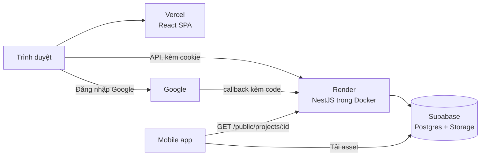
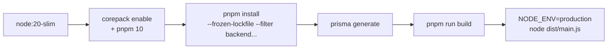

# Deployment

| Phần | Nơi chạy | Ghi chú |
|---|---|---|
| [[Frontend]] | Vercel | `frontend/vercel.json` đã có rewrite SPA (mọi đường dẫn về `index.html`), nên `/oauth-callback`, `/reset-password` không bị 404. Đặt `VITE_API_URL` trỏ tới backend |
| [[Backend]] | Render (Docker) | `render.yaml` ở gốc repo, dịch vụ `ar-backend`, gói free |
| Database + Storage | Supabase | [[Database-Schema]], [[Supabase-Storage]] |

## Docker backend (`backend/Dockerfile`)
Node 20-slim, bật `corepack` + pnpm 10, `pnpm install --frozen-lockfile --filter backend...`, **`prisma generate`**, `pnpm run build`, `NODE_ENV=production`, mở cổng 3000, chạy `node dist/main.js`.

## Render
- Import `render.yaml` bằng Blueprint, rồi điền các biến có `sync: false` trong phần Environment ([[Environment-Variables]]).
- **`render.yaml` hiện chỉ liệt kê** `PORT`, `SUPABASE_*`, `JWT_*`, `DIRECT_URL`, `CORS_ORIGIN`. Các biến thêm cho Google OAuth và reset mật khẩu (`GOOGLE_CLIENT_ID`, `GOOGLE_CLIENT_SECRET`, `GOOGLE_CALLBACK_URL`, `FRONTEND_URL`) **cần được thêm vào file này và điền trên Render**, nếu không backend không khởi động.
- Khi lên production: thêm URI callback thật vào Google Console; `GOOGLE_CALLBACK_URL` dùng domain Render.
- Cookie refresh ở production là `Secure` + `SameSite=None` ([[Auth-Tokens]]); `CORS_ORIGIN` phải đúng domain frontend.
- Gói free của Render ngủ khi không có truy cập, request đầu có thể chậm.
- Swagger tắt ở production ([[Swagger-Docs]]). Sau mỗi lần đổi schema nhớ chạy lại `db:push` cho DB thật và RLS ([[Row-Level-Security]]).

Các bước build image:

Chạy local: [[Dev-Setup]].
