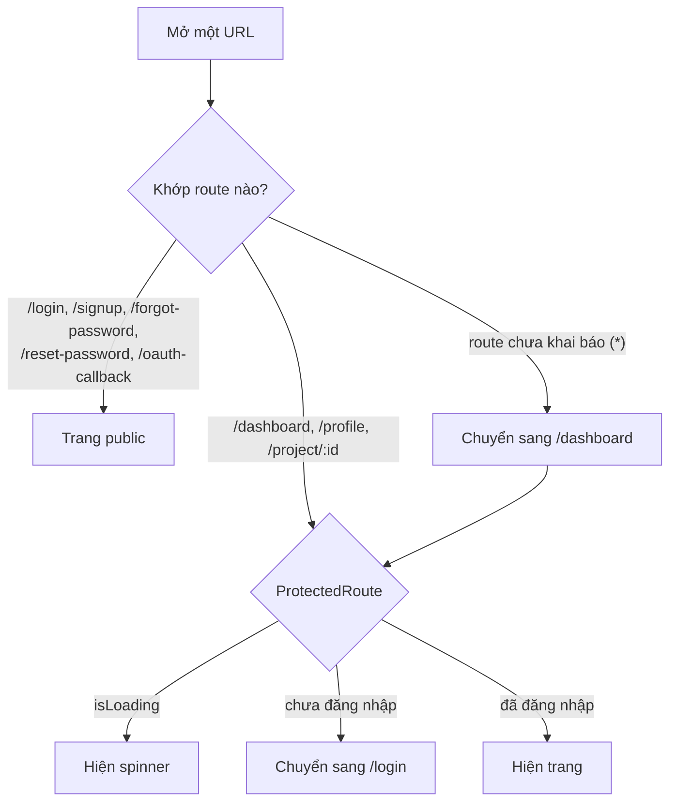

# Frontend-Routes

Định nghĩa trong `App.tsx` (React Router).

| Đường dẫn | Quyền | Trang | Ghi chú |
|---|---|---|---|
| `/login` | public | Login | Có link quên mật khẩu và nút Google; đọc `?error=google_auth_failed` |
| `/signup` | public | Signup | Có nút Google |
| `/forgot-password` | public | ForgotPassword | → [[Auth-Password-Reset]] |
| `/reset-password?token=` | public | ResetPassword | Token lấy từ link trong email |
| `/oauth-callback?token=` | public | OAuthCallback | Đích sau [[Auth-Google-OAuth]] |
| `/profile` | cần đăng nhập | Profile | Đổi tên, đổi mật khẩu → [[API-Users]] |
| `/dashboard` | cần đăng nhập | Dashboard | Danh sách project |
| `/project/:id` | cần đăng nhập | ProjectEditor | → [[Project-Editor]] |
| `*` | — | — | Chuyển về `/dashboard` |

**Lưu ý:** route `*` nuốt mọi đường dẫn chưa khai báo và đẩy về `/dashboard`, rồi nếu chưa đăng nhập thì tiếp tục bị đẩy sang `/login`. Quên đăng ký một route mới sẽ trông giống "bị kẹt ở trang login", xem [[Troubleshooting]].

`ProtectedRoute` kiểm tra `isAuthenticated` từ [[Frontend-AuthContext]].
