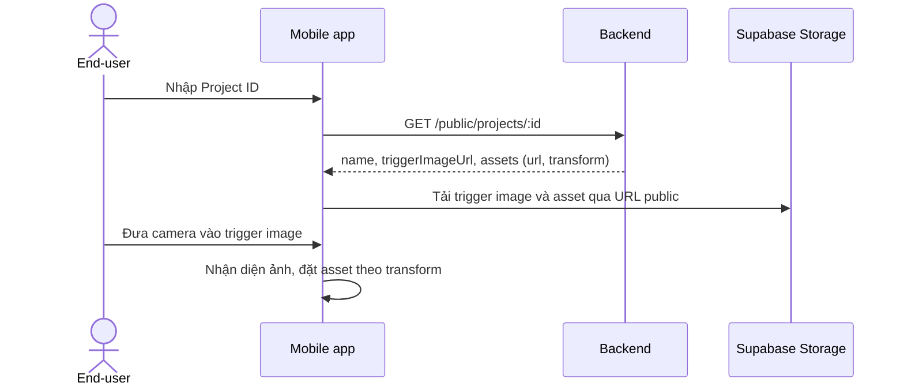

# Mobile-App

App cho **end-user** quét trigger image và xem nội dung AR. Không cần đăng nhập.

- README của repo chính mô tả thư mục `mobile/` (React Native + ViroReact), loại khỏi pnpm workspace. Bản mã nguồn đã đọc để viết tài liệu này **không chứa** thư mục đó; còn có repo riêng `HaoKiet10/ARMobile` (React Native CLI, TypeScript). Tại thời điểm viết, repo đó còn rất sơ khai.
- Luồng dự kiến: nhập Project ID → `GET /public/projects/:id` ([[API-Public-Scan]]) → tải trigger image và asset từ URL public ([[Supabase-Storage]]) → nhận diện ảnh bằng camera → đặt asset theo [[Asset-Transform]].

Đây là luồng dự kiến, vì phần mobile chưa hoàn thiện.

- Chỉ truy cập được project đã công bố ([[Publish-Flow]]).
- Mobile **không gọi thẳng Supabase**, nên bật RLS không ảnh hưởng ([[Row-Level-Security]]).
- Việc nên làm: QR/deep link thay cho nhập ID ([[Roadmap]]); dùng [[Swagger-Docs]] làm hợp đồng API.

Bối cảnh chung: [[Architecture]].
