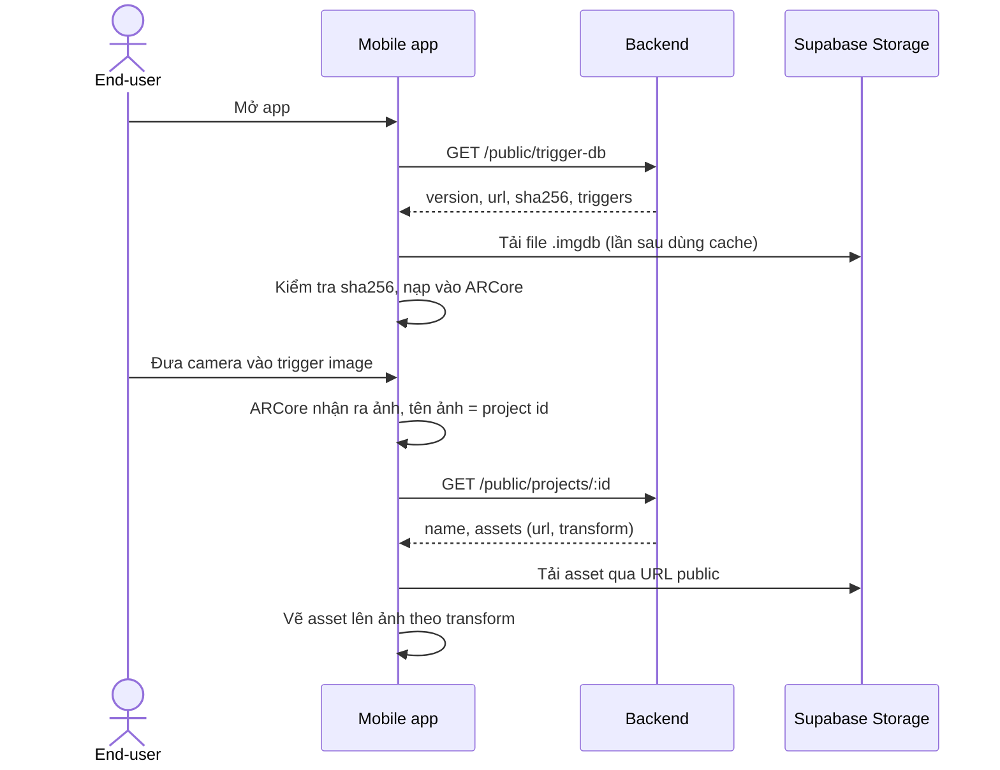

# Mobile-App

App cho **end-user** quét trigger image và xem nội dung AR. Không cần đăng nhập, **không cần nhập Project ID**.

- Repo riêng `HaoKiet10/ARMobile`: React Native 0.86, **chỉ Android**, native module ARCore tự viết (đã gỡ `react-viro`). Không nằm trong pnpm workspace của repo này vì xung đột version `react`.
- Tài liệu chi tiết nằm trong thư mục `wiki/` của repo đó (bắt đầu từ note `Index`): luồng màn hình, native view, cache database, render ảnh/video/model, đổi toạ độ, lỗi hay gặp.

## Luồng

- Database nhận diện do server dựng: [[Trigger-Database]]. Route: [[API-Public-Scan]].
- Chỉ quét được project đã công bố ([[Publish-Flow]]); publish xong khoảng vài giây sau mobile mới nhận ra ảnh mới.
- Đặt asset theo [[Asset-Transform]]: toạ độ tương đối × 0.15 m, hằng số phải khớp giữa backend và mobile.
- Loại asset hiển thị được: ảnh (png, jpg, jpeg, gif, webp), video (mp4, mov, m4v, webm), model `.glb`. `.gltf` dạng text bị bỏ qua dù [[Upload-Validation]] cho upload; nên khuyên designer dùng `.glb`.
- Mobile **không gọi thẳng Supabase API**, nên bật RLS không ảnh hưởng ([[Row-Level-Security]]).
- App gọi backend production (URL Render viết cứng); gói free ngủ nên lần mở đầu có thể chờ tới 1 phút ([[Deployment]]).

Bối cảnh chung: [[Architecture]]. Việc còn thiếu: [[Roadmap]].
