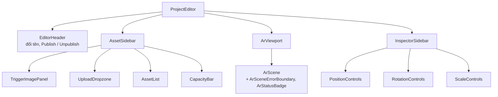

# Project-Editor

Trang `/project/:id`, thư mục `frontend/src/pages/ProjectEditor/`. Đây là nơi designer dựng cảnh AR.

## Bố cục

- **EditorHeader** — đổi tên project, Publish/Unpublish ([[Publish-Flow]]).
- **AssetSidebar** — `TriggerImagePanel` (ảnh nhận diện), `UploadDropzone`, `AssetList`, `CapacityBar` (giới hạn 5 MB mỗi project, hằng `MAX_PROJECT_SIZE_MB`).
- **ArViewport / ArScene** — xem trước cảnh 3D (theo tên file `aframe.d.ts` và `useAframeScript`, dùng A-Frame).
- **InspectorSidebar** — chỉnh Position / Rotation / Scale của asset đang chọn ([[Asset-Transform]]).

## Hook
`useProjectData` (tải project), `useAssetUpload`, `useAssetActions` (xoá, khôi phục, nhân bản), `useAssetTransform`, `useSpatialSave`, `useAutoSave`, `useUndoRedo`, `useAssetKeyboardShortcuts`, `useProjectRename`, `useAframeScript`.

## API sử dụng
[[API-Projects]] (project, trigger image, publish) và [[API-Assets]] (asset, transform, duplicate, restore). Xoá asset là xoá mềm nên hoàn tác được ([[Database-Schema]]).

Giới hạn upload và loại file: [[Upload-Validation]]. Thuộc về [[Frontend]].
