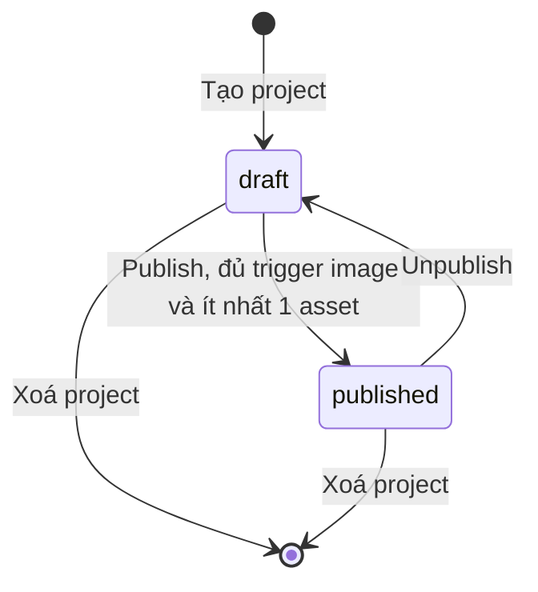
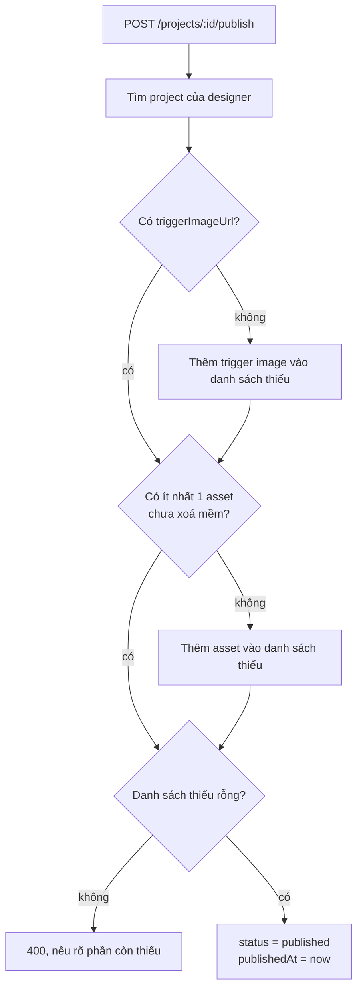

# Publish-Flow

Trạng thái project: `draft` → `published` (và `archived`, chưa có route đặt) — cột `status` ([[Database-Schema]]).

Trạng thái `archived` có trong schema nhưng chưa có route nào đặt.

## Điều kiện publish (`ProjectService.publish`, [[Module-Project]])
Thiếu một trong hai là lỗi 400, thông báo liệt kê phần còn thiếu:
1. Có **trigger image** (`triggerImageUrl`).
2. Có **ít nhất 1 asset** còn hiệu lực (không tính asset xoá mềm).

Thành công thì đặt `status = published` và `publishedAt = now`. `POST /projects/:id/unpublish` đưa về `draft` và xoá `publishedAt` ([[API-Projects]]).

## Hệ quả
- Chỉ project `published` mới truy cập được bằng route public ([[API-Public-Scan]]), nên [[Mobile-App]] chỉ quét được project đã công bố.
- Sau khi publish, designer vẫn sửa được asset; thay đổi có hiệu lực ngay với người quét vì mobile đọc dữ liệu trực tiếp.
- Nút Publish/Unpublish nằm ở header của [[Project-Editor]].

Giới hạn upload ảnh trigger và asset: [[Upload-Validation]].
