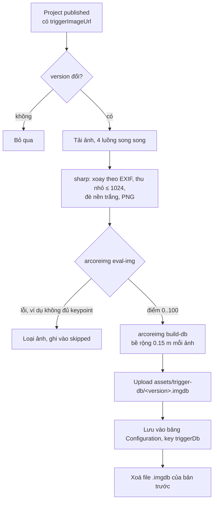

# Trigger-Database

ARCore cần một **AugmentedImageDatabase** để nhận diện trigger image. Đây không phải database SQL: nó là bộ "dấu vân tay" (feature point) trích từ từng ảnh, mỗi ảnh gắn một tên — ở đây tên = **project id**. File `.imgdb` là bộ đó serialize ra đĩa.

Database được **dựng trên server** (`backend/src/modules/project/trigger-db.service.ts`, `TriggerDbService`, [[Module-Project]]) bằng tool `arcoreimg` của Google, rồi [[Mobile-App]] chỉ tải đúng một file. Nhờ vậy end-user không cần nhập Project ID: đưa camera vào ảnh của bất kỳ project đã publish nào là app nhận ra.

## Khi nào dựng lại
`ProjectService` gọi `scheduleRebuild()` khi tập ảnh trigger của project đã publish có thể đổi: publish, unpublish, upload/xoá trigger image của project đang publish, xoá project đang publish ([[Publish-Flow]]). Server khởi động cũng hẹn dựng một lần.

- Gom các thay đổi liên tiếp trong 3 giây; mỗi lúc chỉ một lần dựng, có thay đổi trong lúc dựng thì dựng thêm một lần sau.
- `version` = hash của (danh sách id + URL ảnh trigger) cùng `BUILD_FORMAT`, bề rộng 0.15 m, cỡ ảnh 1024. Trùng `version` với bản đang lưu thì bỏ qua.
- Tối đa `MAX_SCAN_TRIGGERS = 1000` project (mới cập nhật trước) — trần của ARCore.

## Các bước dựng

- Nền trắng: PNG trong suốt làm ARCore mất feature.
- Điểm `eval-img` < 75 chỉ là cảnh báo trong log; ảnh mà `eval-img` báo lỗi bị loại vì nó làm `build-db` hỏng cả database.
- Không còn project nào publish → lưu bản ghi với `url = null`, `triggers = []`.
- Bản ghi trong `Configuration` ([[Database-Schema]]): `version`, `url`, `sha256`, `size`, `storageKey`, `triggers`, `skipped` (id + lý do), `builtAt`.

## Route cho mobile
`GET /public/trigger-db` → `{ version, url, sha256, size, triggers }` ([[API-Public-Scan]]). Chưa dựng xong lần nào (server vừa khởi động, hoặc thiếu `arcoreimg`) thì trả **503**. Mobile tải file theo `url` từ [[Supabase-Storage]], kiểm tra HTTP 200 + sha256 rồi mới lưu cache và nạp vào ARCore (chi tiết: wiki repo ARMobile, note `Trigger-DB-Cache`).

## Hằng số phải khớp
`NOMINAL_MARKER_WIDTH_M = 0.15` (backend) phải bằng `NOMINAL_MARKER_WIDTH` trong `ARScanScreen.tsx` (mobile). ARCore ước lượng pose theo bề rộng này, còn mobile nhân toạ độ tương đối của asset với cùng số ([[Asset-Transform]]).

## Vận hành
- `arcoreimg` là binary Linux, được tải vào image Docker (`backend/Dockerfile`, ghim theo commit của `arcore-android-sdk`) ([[Deployment]]).
- Chạy backend local trên Windows: tải `arcoreimg.exe` từ `arcore-android-sdk/tools/arcoreimg` và đặt `ARCOREIMG_PATH` ([[Environment-Variables]]). Thiếu tool thì server log lỗi và route trả 503.
- Đổi cách tiền xử lý ảnh → tăng `BUILD_FORMAT` để mọi máy tải database mới.
- Project bị loại: xem log `Bỏ ảnh trigger của project …` hoặc field `skipped` ([[Troubleshooting]]).
