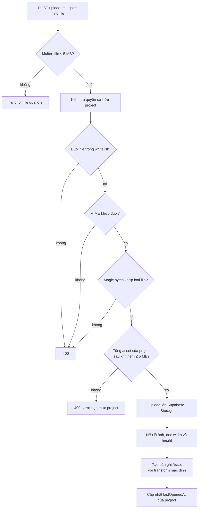

# Upload-Validation

Logic ở `asset-validation.ts` ([[Module-Project]]), áp cho cả [[API-Assets]] và trigger image ([[API-Projects]]).

## Giới hạn
- Mỗi file ≤ **5 MB** (chặn ngay tại `FileInterceptor`).
- Tổng asset còn hiệu lực của một project ≤ **5 MB**. Giao diện hiển thị bằng thanh `CapacityBar` ([[Project-Editor]]).

## Loại file cho asset
`.png`, `.jpg`, `.jpeg`, `.mp4`, `.webm`, `.glb`, `.gltf`.

## Trigger image
Chỉ ảnh raster: `.png`, `.jpg`, `.jpeg`.

## Cách kiểm tra
1. Đuôi file nằm trong whitelist.
2. MIME type khớp đuôi.
3. **Magic bytes** của nội dung khớp loại file (`.gltf` là JSON nên chỉ kiểm tra parse được).

## Cố ý không cho `.svg`
SVG có thể chứa `<script>` và bị trình duyệt chạy khi mở thẳng URL file (stored XSS qua upload), không đáng đánh đổi ([[Security-Notes]]).

File được lưu ở [[Supabase-Storage]].
